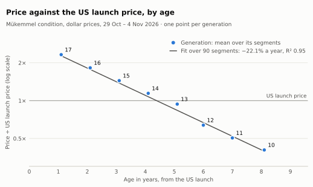
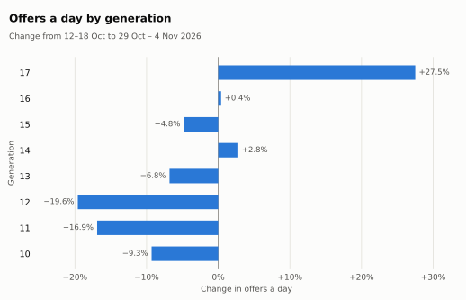
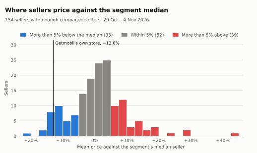
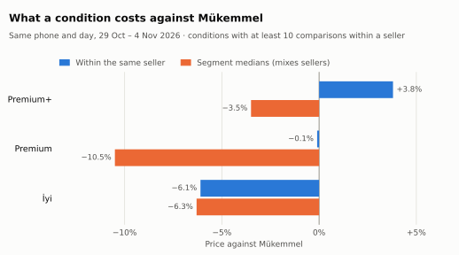

# Refurbished iPhones in Turkey: pilot market report

**Period:** 12 October – 4 November 2026 (24 days). Cross-sectional figures use the last 7 days (29 October – 4
November).

**Source:** every in-stock offer of every seller on Getmobil, collected nightly, and the TCMB USD/TRY rate.

This is the first of the monthly reports and covers less than four weeks of data. Comparisons between models, conditions
and sellers on the same days are reliable already. Movements over time are not yet: the price index finished its base
period on 2 November, and the next report follows it.

## 1. Summary

- **A model one year older sells for about 22% less in dollars.** The rule holds from 1-year-old to 8-year-old models
  and for Pro and non-Pro models alike. The one exception is the step from the iPhone 12 to the iPhone 13 generation,
  where the gap is 32%.
- **The same phone in the same condition costs up to 18% less from the cheapest seller.** In segments with ten or more
  sellers, the cheapest offer is typically 17.6% (about 8,800 TL) below the median offer.
- **Condition labels cost less than they appear to.** Within the same seller, Premium is priced like Mükemmel and İyi
  6% below it. Segment medians show bigger discounts because Getmobil's own, cheaper store sells most Premium offers.

## 2. Price index and exchange rate

| | Value |
|---|---|
| Offers a day (last 7 days) | 1,579, from 253 sellers |
| Getmobil's own store | 18.3% of offers |
| Median offer | 58,499 TL ($1,173) |
| Offers against the first week | −4.6% |
| USD/TRY, 12 Oct → 4 Nov | 49.22 → 50.00 (+1.6%) |
| Price index, 4 Nov (base 20 Oct – 2 Nov = 100) | 99.3 in lira, 98.8 in dollars |
| Price index over the last 7 days | +0.45% in lira, 0.0% in dollars |

The index follows the median prices of a fixed basket: the segments on sale throughout the base period. Changes in the
mix of models on sale therefore do not move it. Over the last week, lira prices rose about as much as the dollar
(+0.4%), leaving dollar prices flat.

The index is not age adjusted: the phones in the basket get older every day. At the cross-sectional rate of 22% a
year, ageing alone would take about 0.5% a week off dollar prices. Two weeks after the base period are too few to tell
this apart from market movements. The age-adjusted index, which will be compared with inflation, comes with the price
model.

## 3. Models

**Depreciation.** For each segment in Mükemmel condition, the dollar price is divided by the US launch price.

<picture>
  <source media="(prefers-color-scheme: dark)" srcset="figures/2026-11/depreciation-dark.svg">
  
</picture>

| Generation | Age (years) | Price ÷ US launch price | Against one generation newer |
|---|---|---|---|
| 17 | 1.1 | 2.32 | |
| 16 | 2.1 | 1.82 | −21.5% |
| 15 | 3.1 | 1.44 | −21.0% |
| 14 | 4.1 | 1.14 | −20.7% |
| 13 | 5.1 | 0.94 | −17.9% |
| 12 | 6.0 | 0.64 | −32.0% |
| 11 | 7.0 | 0.51 | −20.8% |
| 10 (X, XS, XS Max, XR) | 8.1 | 0.41 | −19.8% |

US launch prices exclude Turkish taxes, which is why young models sell above them. The ratio compares models with one
another; it is not a loss of value in itself.

A fit over 90 segments gives a loss of 22.1% per year of age (R² 0.95). The rate is the same for Pro and Pro Max models
(22.2%) as for the others (22.1%).

**Storage.** Apple's launch price rises a median 14.3% from one storage size to the next. On the refurbished market the
step is 7.5%. Single models vary widely, because different sellers sell different sizes.

**Supply.** Offers of the newest generation (iPhone 17 and Air) rose 27.5%, from 83 to 105 a day, against the first
week. The iPhone 11 and 12 generations fell by 17–20%. In the archived weeks every nightly run completed, and the
number of variants the site lists fell with the offers. The decline in supply is therefore the site's, not a gap in
the collection.

<picture>
  <source media="(prefers-color-scheme: dark)" srcset="figures/2026-11/supply-dark.svg">
  
</picture>

Offers a day by generation

| Generation | 12–18 Oct | 29 Oct – 4 Nov | Change |
|---|---|---|---|
| 17 | 82.7 | 105.4 | +27.5% |
| 16 | 282.4 | 283.6 | +0.4% |
| 15 | 254.4 | 242.3 | −4.8% |
| 14 | 293.9 | 302.0 | +2.8% |
| 13 | 332.1 | 309.6 | −6.8% |
| 12 | 179.4 | 144.3 | −19.6% |
| 11 | 210.9 | 175.1 | −16.9% |
| 10 | 18.4 | 16.7 | −9.3% |

## 4. Sellers

**Spread.** On a given day, offers for the same model, storage and condition lie this far apart:

| Sellers in the segment | Share of segment-days | Interquartile range | Cheapest offer below the median |
|---|---|---|---|
| 1 | 30% | | |
| 2–3 | 29% | 7.4% | 5.6% (2,500 TL) |
| 4–9 | 27% | 11.0% | 9.4% (5,000 TL) |
| 10 or more | 14% | 17.7% | 17.6% (8,800 TL) |

**Getmobil's own store** prices 13% below the median seller of the segments it shares with at least two others. It is
below the median in 92% of them and the cheapest seller in 53%.

**The other sellers** price 1% above the median on average. Of the 154 with enough comparable offers:

- 33 price more than 5% below the median;
- 82 price within 5% of it;
- 39 price more than 5% above it.

<picture>
  <source media="(prefers-color-scheme: dark)" srcset="figures/2026-11/sellers-dark.svg">
  
</picture>

Sellers are not named in this report.

**Conditions.** A seller's price for a condition is compared with its own Mükemmel offer of the same phone on the same
day:

<picture>
  <source media="(prefers-color-scheme: dark)" srcset="figures/2026-11/conditions-dark.svg">
  
</picture>

| Condition | Share of offers | Within the same seller | Getmobil's own store | Other sellers | Segment medians |
|---|---|---|---|---|---|
| Premium+ | 21.8% | +3.8% | +4.1% | +3.2% | −3.5% |
| Premium | 3.4% | −0.1% | −0.1% | −0.4% | −10.5% |
| İyi | 10.6% | −6.1% | −8.9% | 0.0% | −6.3% |

Comparing segment medians gives the wrong sign for Premium+. Getmobil's own store, which prices below the other
sellers, sells 33% of Premium+ and 68% of Premium offers, but only 8% of Mükemmel ones. The medians of those
conditions therefore compare stores as much as conditions.

The discount for İyi exists only in Getmobil's own store: the other sellers price İyi like Mükemmel.

## 5. Recommendations

**For buyers**

- Compare sellers before buying. Where ten or more sellers offer the same phone, the cheapest is typically 18% below
  the median, about 8,800 TL.
- A cheap Premium offer is cheap because of its seller, not its label: within the same seller Premium costs the same
  as Mükemmel. Premium+, Getmobil's tier with all components original, costs about 4% more.
- For an İyi phone, look at Getmobil's own store, about 9% below its Mükemmel price. Elsewhere İyi costs the same as
  Mükemmel, so Mükemmel is the better buy there.
- Larger storage is cheap second-hand: the step to the next size costs about half of Apple's step.

**For sellers**

- Sellers that price İyi like Mükemmel compete with Getmobil's own İyi offers about 9% lower.
- In busy segments the range between the cheapest and the dearest offer is 39% of the median. Whether offers more than
  5% above the median stay on sale longer will be measured once there are enough ended offers (A8).

## 6. Method and limitations

- **Data.**
  - Public product pages on Getmobil, read once a night with one request at a time.
  - Each offer (one variant, one seller) is stored with its price, stock and condition, under the seller's numeric id.
  - Dollar prices use the TCMB forex selling rate announced on the last business day before the day.
- **Segment.** Model + storage + Getmobil's condition label. Medians are over in-stock offers.
- **Depreciation is cross-sectional.** It compares models of different ages on the same days, not one model as it
  ages; the latter needs about eight weeks of data.
- **Condition and storage comparisons on segment medians mix sellers.** Within-seller figures are given where the marts
  hold them.
- **Supply.** Counted in offers, not stock units: a few sellers' declared stock drives the unit count. An offer that
  leaves the site is not necessarily sold.
- **One platform.** A comparison between platforms is suspended until a second refurbished source is available.
- **Reproducible.** Every figure comes from the analyses in `dbt/analyses` (methods in
  [docs/analyses.md](../docs/analyses.md)). The `analysis` workflow runs them again for any end date and draws the
  charts from their tables.
